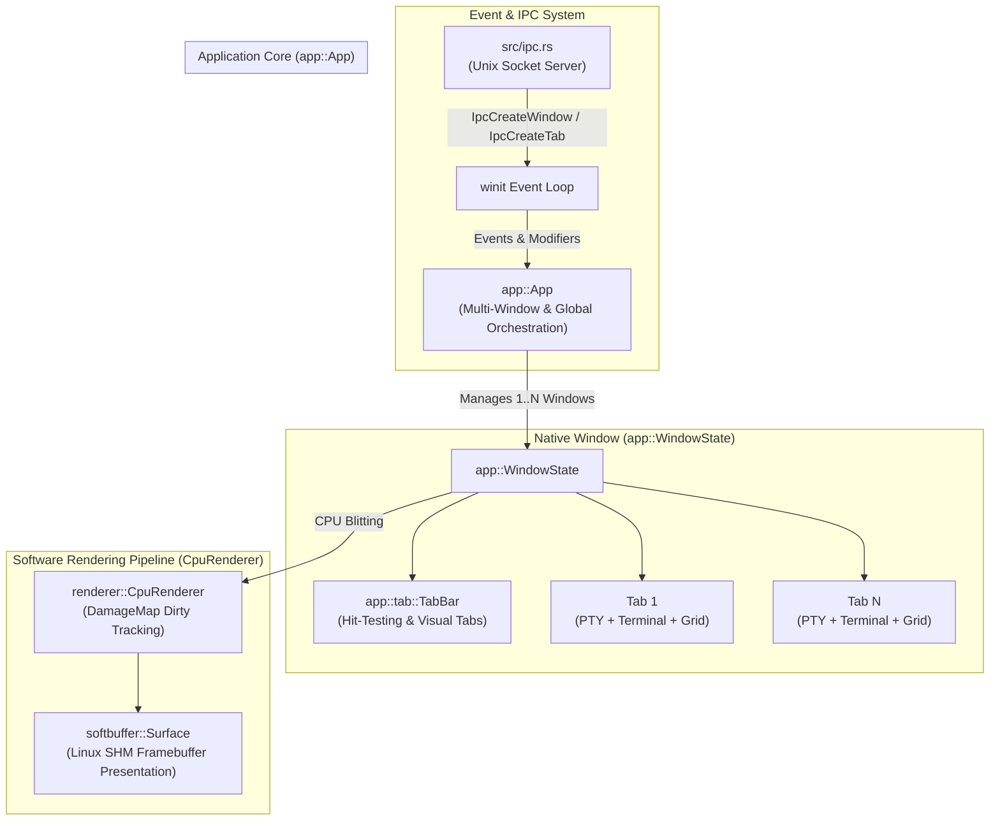
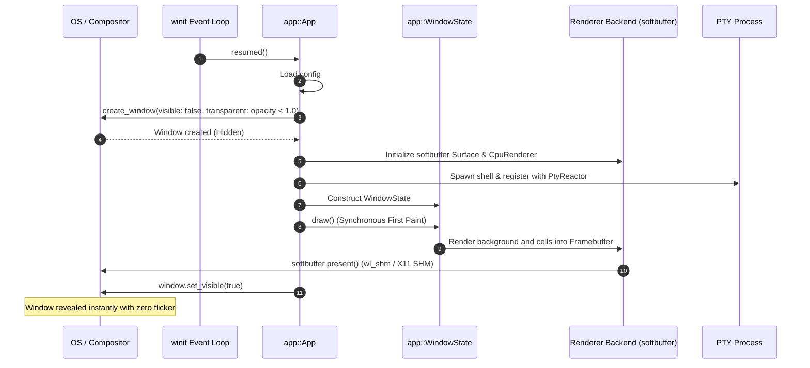

# Velox Architecture Documentation

## Overview

Velox is a modular, high-performance terminal emulator built around focused, decoupled Rust modules. The system architecture coordinates an event-driven multi-window/multi-tab application runtime, asynchronous pseudo-terminal (PTY) streams, VT/ANSI protocol engines, a pure-Rust CPU software rendering pipeline via `softbuffer`, synthetic typography fallbacks, bounded memory paging, and single-instance IPC.

## Architectural Principles

```text
1. Single Responsibility: Each module strictly owns one functional domain.
2. Software-Only Rendering: Pure CPU rasterization and composition.
3. Zero-Allocation Hot Paths: Reuse cell buffers and scratch pixel vectors.
4. Bounded Memory Budgets: Fallback fonts, scrollback history, and glyph caches enforce strict limits.
5. Shared Epoll Reactor: A single background PTY reactor thread services all terminal panes via non-blocking epoll.
6. Zero-Flicker Presentation: Windows render their initial frame synchronously before being mapped.
7. Modular Isolation: Screen grids, tabs, and font sizes operate in clean isolation per tab.
```

## Component Architecture



---

## Core Subsystems

### 1. Platform Windowing & Desktop Identity (`src/platform.rs`, `src/window/`)

- **Native Zero-C Backend Detection**: Detects session type via `VELOX_BACKEND`, `XDG_SESSION_TYPE`, `WAYLAND_DISPLAY`, and `DISPLAY` to dynamically instantiate native pure-Rust X11 (`x11rb`) or Wayland (`wayland-client`) windowing without C library dependencies.
- **Canonical Identity Compliance**:
  - Wayland `app_id`: `io.github.lnoxsian.Velox` (with `"velox"` fallback when uninstalled).
  - X11 `WM_CLASS`: `("velox", "Velox")` adhering to ICCCM standard.
  - Desktop Entry: `io.github.lnoxsian.Velox.desktop` with `StartupWMClass=Velox`.
  - Embedded X11 Icon: EWMH `_NET_WM_ICON` multi-resolution ARGB payload (16x16, 32x32, 48x48, 128x128).

### 2. Application & Window Orchestration (`app::`)

- **`App`**: The top-level `winit::application::ApplicationHandler` managing all active `WindowId -> WindowState` instances, modifier states, single-instance daemon mode, and IPC listener handles.
- **`WindowState`**: Represents an open native window. Owns the `CpuRenderer`, `softbuffer::Surface`, mouse/keyboard interaction state, tab list (`Vec<Tab>`), active tab index, tab bar layout (`TabBar`), render buffers, frame limiter, and window opacity/dimming parameters.
- **`Tab` (`app/tab.rs`)**: Owns an individual tab's execution context: dedicated PTY master, background reader thread, `Terminal` state machine, custom title, hold-on-exit flag, and isolated tab zoom font size.
- **`TabBar` (`app/tab.rs`)**: Manages tab bar layout, visibility modes (`Auto`, `Always`, `Never`), close/new-tab button hit testing, hover states, and generates render metadata (`TabBarRenderInfo`).

### 3. Display Connection & Window Creation (`renderer::backend`)

Velox initializes native Linux windows and display surfaces via `create_window_and_renderer`:

- **Winit Windowing**: Creates windows with explicit Wayland/X11 attributes, initially hidden for zero cold-start flicker.
- **`softbuffer` Surface**: Binds a CPU-accessible shared memory presentation surface (`wl_shm` on Wayland or X11 MIT-SHM on X11) directly to the window.
- **Zero-Size Protection**: Both surface creation and resizing guard against zero width or height by clamping dimensions with `NonZeroU32`, preventing driver panics on Wayland compositors during minimize/unmap transitions.
- **Diagnostics (`src/diagnostics.rs`)**: Standalone system checks inspecting Linux display server connection, font database status, and desktop integration.

### 4. Pure CPU Software Renderer (`renderer::CpuRenderer`)

- Pure-Rust CPU blitting directly to a 32-bit linear ARGB `Framebuffer` presented via `softbuffer`.
- Fine-grained `DamageMap` row tracking: only dirty terminal rows and damaged glyph spans are redrawn, achieving near-zero CPU usage when idle.
- Full line decoration suite (`decorations.rs`): single, double, curly, dotted, and dashed underlines, strikethrough, block/beam/hollow cursors, and unfocused dimming.
- Fast-path box and block drawing primitives (`primitives.rs`).
- High-efficiency alpha blitters (`raster.rs`) for glyph rasterization onto the CPU buffer.

### 5. Typography & Synthetic Italic Engine (`font::`)

- **`ResolvedFontSet` (`font/resolved.rs`)**: Resolves regular, bold, italic, and bold-italic font faces.
- **Synthetic Italic Shearing (`shear_outline`)**: When an italic font variant is missing on the system, Velox dynamically shears the vector outlines of regular glyphs using horizontal shearing matrices and adjusts bounding boxes to prevent clipping.
- **`FallbackManager` (`font/fallback.rs`)**: Automatically discovers missing glyphs across system fonts (Nerd Fonts, Powerline, emoji fonts) with an LRU cache bounded by a strict memory budget (`MAX_FALLBACK_BYTES = 64MB`).
- **`SYSTEM_FONT_DB`**: Process-wide shared `fontdb::Database` initialized once to eliminate redundant font directory parsing across windows and tabs.

### 6. Terminal State & ANSI Parsing (`terminal::`, `ansi::`, `input::`)

- **Byte Stream Parser (`ansi/`)**: High-performance, zero-allocation state machine decoding ANSI escape codes, CSI parameters/intermediates, OSC commands, and DCS control sequences.
- **Terminal Modes & State Machine (`terminal/terminal.rs`, `ansi/csi.rs`)**:
  - **ANSI & DEC Private Modes**:
    - `CSI ? 1 h/l`: Application Cursor Keys (`DECCKM`)
    - `CSI ? 5 h/l`: Reverse-Video Mode (`DECSCNM`)
    - `CSI ? 6 h/l`: Origin Mode (`DECOM`) with `DECSTBM` scroll-margin offset calculations, boundary clamping, and relative DSR reports
    - `CSI ? 7 h/l`: Auto-wrap Mode (`DECAWM`) with in-place right-margin overwrite protection when disabled
    - `CSI ? 25 h/l`: Cursor Visibility (`DECTCEM`)
    - `CSI ? 66 h/l` & `ESC =` / `ESC >`: Application Keypad Mode (`DECKPAM` / `DECKPNM`) emitting standard SS3 sequences
    - `CSI 4 h/l`: Insert/Overwrite Mode (`IRM`) with dynamic rightward row cell shifting
    - `CSI ? 1000/1002/1003/1005/1006/1016 h/l`: Complete mouse tracking (X10, button drag, any motion, UTF-8 coordinate encoding, SGR 1006, and SGR 1016 pixel coordinates)
    - `CSI ? 1004 h/l`: Focus In/Out Event Reporting
    - `CSI ? 2004 h/l`: Bracketed Paste Mode
    - `CSI ? 2026 h/l`: Synchronized Output Mode (atomic frame buffering during burst updates)
    - `CSI ? 47 / 1047 / 1048 / 1049 h/l`: Alternate Screen Buffer lifecycle with automatic screen clearing, homing, and cursor/mode isolation preventing state leakage between primary and alternate sessions
    - `CSI ? <mode> s` / `CSI ? <mode> r`: Save and Restore DEC Private Modes
    - `CSI ? <mode> $ p` & `CSI <mode> $ p`: `DECRQM` / `DECRPM` mode status query reports
  - **Tab Stop Architecture**: Horizontal Tab Set (`ESC H`), Tab Clear (`CSI 0 g`, `CSI 3 g`), Cursor Backward Tab (`CSI Z`), and Forward Tab (`0x09`) respecting custom tab grids.
  - **Terminal Resets**: Full Terminal Reset (`RIS`, `ESC c`) and Soft Terminal Reset (`DECSTR`, `CSI ! p`) restoring protocol state consistently according to DEC STD 070.
  - **Dynamic Color Protocols**:
    - OSC 4: Set and query all 256 indexed palette colors (`rgb:rrrr/gggg/bbbb`)
    - OSC 104: Selective index reset or complete 256-color palette restoration
    - OSC 10, 11, 12: Set and query foreground, background, and cursor colors with renderer damage invalidation
    - OSC 110, 111, 112: Reset dynamic colors back to active theme defaults
  - **Device & Capability Queries**:
    - Primary Device Attributes: VT220 response (`\x1b[?62;c`)
    - Secondary Device Attributes: VT220 DA2 (`\x1b[>0;10;0c`)
    - Tertiary Device Attributes: DA3 (`\x1bP!|00000000\x1b\`)
    - Device Status Report: `CSI 5 n` (OK) and `CSI 6 n` (CPR with origin-mode offset)
    - XTGETTCAP: Advertised capabilities (RGB, TrueColor, 256 colors) with standard clean rejection (`\x1bP0+q\x1b\`) for unsupported queries to prevent application hangs
  - **Keyboard & Mouse Forwarding (`src/input/keyboard.rs`, `src/app/mouse.rs`)**:
    - Transparent passthrough for all unbound key combinations to active PTY (modified arrows, Shift+Tab CBT, Ctrl+letter control codes, Alt+printable keys, function keys, Super/Meta combinations)
    - Kitty Keyboard Protocol support when negotiated
    - Application Keypad SS3 generation in keypad mode
    - Reliable mouse reporting honoring active modes (X10, SGR, UTF-8, pixel SGR) while maintaining local text selection and Ctrl+click hyperlinks when tracking is inactive
  - **Safe Unicode & Grapheme Handling**:
    - Zero-width character handling at column 0 without cursor drift
    - Combining character registry encoding composite glyphs
    - Automatic orphan cleanup: overwriting a wide character or continuation cell resets its partner cell to space
  - **OSC Notifications & Safety**:
    - OSC 7: Current working directory notification
    - OSC 8: Explicit hyperlinks with mouse hover detection
    - OSC 52: Clipboard access with bounded 10MB payload limit to prevent memory exhaustion
    - OSC 133: Shell integration semantic prompt markers
    - OSC 777: Desktop notifications with control character sanitization and rate-limiting

### 7. Screen Buffers & Infinite Scrollback (`screen::`)

- **`Grid` (`screen/grid.rs`)**: Two-dimensional character cell array storing `Cell` entries (character, fg color, bg color, `CellFlags`). Supports wide characters (emojis, CJK), cursor placement, and full line reflow on resize.
- **Chunked Infinite Scrollback (`screen/scrollback.rs`)**: Paged scrollback architecture that stores history in contiguous chunks with bounded RAM cache and disk backing, allowing millions of lines of history without unbounded memory growth.
- **`Selection` (`screen/selection.rs`)**: Multi-mode text selection (character, word, line) supporting normal and alternate grids with clipboard copy integration.

### 8. Memory Management & Allocator Trimming (`src/memory.rs`)

- **Allocator Trimming (`trim_allocator_memory`)**: Automatically calls OS-level memory trim functions (e.g. `malloc_trim` on Linux glibc) when tabs close or after 2.5 seconds of PTY inactivity.
- **Buffer Retention Limits**: Render cell buffers shrink when capacities exceed 2x normal viewport needs, preventing heap bloat after viewing dense burst outputs.

### 9. Single-Process IPC Architecture (`src/ipc.rs`)

- Display-isolated Unix domain socket server running on the main event loop.
- Supports CLI commands `velox msg create-window` and `velox msg create-tab` to launch new windows or tabs in an existing running Velox process in under 3ms.

### 10. PTY Process Execution & Environment Architecture (`src/pty/process.rs`)

- **Environment Inheritance**: Velox inherits the parent process environment by default and never calls `env_clear()`. System environment variables including `PATH`, `HOME`, `USER`, `LOGNAME`, `SHELL`, locale variables (`LANG`, `LANGUAGE`, `LC_*`), proxy variables (`HTTP_PROXY`, `HTTPS_PROXY`, `NO_PROXY`), session/desktop variables (`XDG_*`, `DBUS_*`, `DISPLAY`, `WAYLAND_DISPLAY`), and authentication sockets (`SSH_AUTH_SOCK`) are fully preserved without alteration or empty fallbacks.
- **Terminal Capability Variables**: Velox centrally configures only terminal-describing variables via `configure_terminal_environment`:
  - `TERM=xterm-256color`: Identifies terminal capabilities and xterm-compatible 256-color escape code parsing.
  - `COLORTERM=truecolor`: Identifies 24-bit direct color (truecolor) support.
- **Terminator / VTE Isolation**: Terminator and VTE-specific environment variables (`VTE_VERSION`, `TERMINATOR_DBUS_NAME`, `TERMINATOR_DBUS_PATH`, `TERMINATOR_UUID`) are not required and are not set or emulated.
- **Terminfo Preservation**: `TERMINFO` and `TERMINFO_DIRS` are intentionally preserved from the parent environment and not overwritten.
- **Package Manager Neutrality**: `DEBIAN_FRONTEND` is not set by Velox; package-manager behavior and Debian frontend configurations are never modified.

---

## Data Flow & Lifecycle

### 1. Zero-Flicker Cold Startup Sequence



### 2. Runtime Execution Loop & I/O Pipeline

```mermaid
flowchart LR
    subgraph PTYStream["PTY Background Reactor (Single Thread)"]
        Shell["Shell / Subprocess"]
        PTYMaster["PTY Master Descriptor"]
        PTYReactor["Shared PtyReactor<br/>(epoll multiplexer)"]
        Shell <--> PTYMaster
        PTYMaster --> PTYReactor
    end

    subgraph EventLoop["Main Thread (winit Event Loop)"]
        Proxy["EventLoopProxy<br/>(CustomEvent::PtyData)"]
        Parser["ansi::Parser<br/>(VT / CSI / OSC Byte Stream)"]
        Term["terminal::Terminal<br/>(Grid & Alternate Screen)"]
        PTYReactor -->|Bytes| Proxy
        Proxy --> Parser
        Parser --> Term
    end

    subgraph RenderSubsystem["Rendering & Presentation"]
        Damage["screen::DamageMap / Dirty Grid"]
        Renderer["renderer::CpuRenderer"]
        Surface["Display Surface<br/>(softbuffer SHM)"]
        Term --> Damage
        Damage --> Renderer
        Renderer --> Surface
    end
```



---

## Testing & Quality Assurance

Velox maintains a test suite covering:
- Terminal emulation compliance, CSI/OSC/DCS escape sequences, SGR color resolution, and alternate screens.
- Tab management, per-tab font zoom isolation, and hit testing.
- Infinite scrollback paging, chunk flushing, and bounded RAM stability under 1,000,000+ line stress.
- Synthetic italic outline shearing math and font fallback eviction budgets.
- CPU software renderer damage tracking, blitting, and line decorations.

