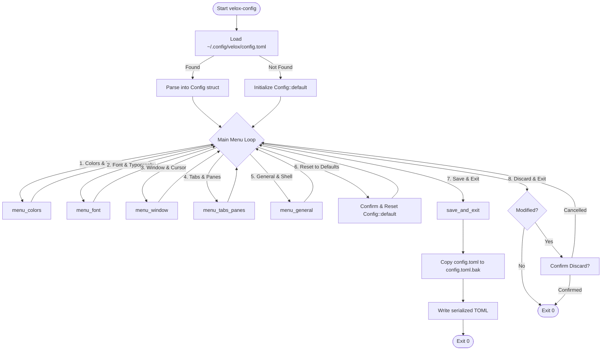

# Velox CLI Configurator (`velox-config`) Plan & Specification

This document defines the architectural specification, user interaction flow, and implementation plan for `velox-config`—a dedicated helper CLI program packaged with Velox to configure the terminal via an interactive terminal menu and generate/update `~/.config/velox/config.toml`.

---

## 1. Executive Summary & Goals

### 1.1 Purpose
While Velox supports full customization through its TOML configuration file, manual TOML editing requires users to know valid keys, types, valid hex formats, and color palettes. `velox-config` provides a guided, interactive menu-driven interface to adjust terminal settings with immediate feedback (live color swatches, incremental steppers, filterable font lists, and preset pickers).

### 1.2 Core Requirements
- **Integrated Packaging:** Ships as a secondary binary (`velox-config`) within the main Velox repository.
- **Zero Duplication:** Reuses Velox's existing `Config`, `FontConfig`, `WindowConfig`, `ConfigColors`, `TabsConfig`, and `PanesConfig` types directly from `velox::config`.
- **Inline Interactive Terminal Experience:** Employs clean interactive arrow-key menus (`inquire`) directly in the normal terminal stream without capturing or clearing the entire terminal screen.
- **Direct Hex Color Workflow:** Gives users full control to input hex codes for all 16 ANSI colors and foreground/background colors, with preset themes available as a fallback.
- **Live Visual Validation:** Displays 24-bit TrueColor ANSI swatches next to hex inputs and offers steppers for numeric bounds.
- **Safe Persistence:** Loads existing user configuration if present, and creates an automatic backup (`config.toml.bak`) before saving updates.

---

## 2. Project Architecture & Workspace Layout

`velox-config` is defined as a secondary binary in `Cargo.toml`:

```toml
# Cargo.toml
[[bin]]
name = "velox"
path = "src/main.rs"

[[bin]]
name = "velox-config"
path = "src/bin/velox-config.rs"
```

### Module Dependencies
Because `velox-config.rs` is part of the `velox` crate workspace, it directly imports:
- `velox::config::{Config, FontConfig, WindowConfig, ConfigColors, TabsConfig, PanesConfig, TabBarVisibility}`
- `velox::config::loader::config_path`
- Built-in theme presets embedded from `assets/velox_terminal_themes/*.toml`

### Third-Party Crates Required
- **None!** (Uses 0 additional crates; built entirely with the Rust standard library and Velox's existing `nix` dependency).

---

## 3. High-Level Flow & Lifecycle



---

## 4. Category Specifications & Input Contracts

### 4.1 🎨 Colors & Theme (`menu_colors`)

#### Submenu Display
Displays all 18 color entries with their current value and a 24-bit TrueColor square swatch (`\x1b[48;2;R;G;Bm  \x1b[0m`):
1. **Core:** `default_fg`, `default_bg`
2. **Standard ANSI (0–7):** `black`, `red`, `green`, `yellow`, `blue`, `magenta`, `cyan`, `white`
3. **Bright ANSI (8–15):** `bright_black`, `bright_red`, `bright_green`, `bright_yellow`, `bright_blue`, `bright_magenta`, `bright_cyan`, `bright_white`

#### Available Submenu Actions
- **Edit Individual Color:** Select a specific color from the list to enter a new hex value.
- **Sequential 18-Color Walkthrough:** Sequentially prompts for Foreground, Background, and all 16 ANSI colors with existing values pre-filled.
- **Load Preset Theme (Fallback):** Select from embedded presets (`assets/velox_terminal_themes/*.toml`):
  - Ayu Dark / Ayu Light
  - Catppuccin Mocha / Macchiato / Frappe / Latte
  - Gruvbox Dark / Gruvbox Light
  - Rose Pine / Rose Pine Moon / Rose Pine Dawn
  - Solarized Dark / Solarized Light
  - GitHub Dark / GitHub Light

#### Hex Input Contract (`input_hex_color`)
- **Format:** Accepts both `#RRGGBB` and `RRGGBB` (automatically prepends `#`).
- **Validation:** Enforces 6 valid hex characters (`[0-9a-fA-F]`).
- **Feedback:** Invalid strings produce an immediate inline error without advancing. Valid strings print a rendered color preview block next to the prompt.

---

### 4.2 🔤 Font & Typography (`menu_font`)

| Setting | Field | Input Type / Control | Default | Constraints / Behavior |
| :--- | :--- | :--- | :--- | :--- |
| **Font Family** | `font_family` | Scrollable List + Monospace Toggle + Name Search + Custom Input | `"monospace"` | Shows all installed system fonts with a toggle for 'Monospace only' vs 'All fonts' + name keyword search filter ('nerd', 'code', 'sans', etc.) + manual text entry |
| **Font Size** | `font_size` | Stepper (`+0.5` / `-0.5`) + Direct Float | `14.0` | Range: `6.0` to `72.0` pt |
| **Scale Multiplier** | `font_scale_multiplier` | Stepper (`+0.1` / `-0.1`) + Direct Float | `1.5` | Range: `1.0` to `3.0` |
| **Bold is Bright** | `bold_is_bright` | Toggle `[ON / OFF]` | `true` | Boolean toggle |
| **Line Height** | `line_height` | Stepper (`+0.05` / `-0.05`) + Direct Float | `None` | Option to specify line height multiplier or keep at default |
| **Nerd Font Glyph Size** | `nerd_font_scale` | Stepper (`+0.05` / `-0.05`) + Direct Float | `None` (1.0) | Range: `0.2` to `3.0` (default 1.0x). Scale multiplier for Nerd Font symbols/glyphs |

---

### 4.3 🪟 Window & Cursor (`menu_window`)

| Setting | Field | Input Type / Control | Default | Constraints / Behavior |
| :--- | :--- | :--- | :--- | :--- |
| **Cursor Shape** | `cursor_shape` | Preset Selection | `"block"` | `["Block", "Beam", "Underline", "Hollow"]` |
| **Cursor Blink** | `cursor_blink` | Toggle `[ON / OFF]` | `false` | Boolean toggle |
| **Cursor Color** | `cursor_color` | Hex Input or Blank | `None` | Optional hex string (blank leaves as default terminal fg/inverted) |
| **Cursor Text Color** | `cursor_text_color` | Hex Input or Blank | `None` | Optional hex string (blank leaves as default terminal bg) |
| **Scroll Multiplier** | `scroll_multiplier` | Stepper (`+` / `-`) + Direct Input | `5.0` | Mouse scroll line jump multiplier (step `1.0`, range `1.0` to `20.0`) |
| **FPS Limit** | `fps_limit` | Common Display Presets + Custom | `None` | `["Uncapped (None)", "60 FPS", "120 FPS", "144 FPS", "165 FPS", "240 FPS", "Custom Number"]` |
| **Window Opacity** | `opacity` | Incremental Stepper | `1.0` | Clamped between `0.10` and `1.00`, step `0.05` |
| **Window Dimming** | `window_dim` | Incremental Stepper | `0.0` | Clamped between `0.00` and `1.00`, step `0.05` (unfocused dimming) |
| **Padding X** | `padding_x` | Incremental Stepper | `4.0` | Range: `0.0` to `64.0` px, step `2.0` |
| **Padding Y** | `padding_y` | Incremental Stepper | `4.0` | Range: `0.0` to `64.0` px, step `2.0` |
| **Scrollback Limit** | `scrollback_limit` | Number Input + Stepper | `10000` | Integer line limit |
| **Infinite Scrollback** | `infinite_scrollback` | Toggle `[ON / OFF]` | `false` | Boolean toggle |
| **Scroll on Output** | `scroll_on_output` | Toggle `[ON / OFF]` | `true` | Boolean toggle |
| **Scroll on Keystroke** | `scroll_on_keystroke` | Toggle `[ON / OFF]` | `true` | Boolean toggle |
| **Hide Mouse Typing** | `hide_mouse_on_typing` | Toggle `[ON / OFF]` | `false` | Boolean toggle |
| **CSD & Window Decorations** | `csd_theme`, `decorations` | Wayland Check + Mode Selector | `None` | **Host Check:** Checks `WAYLAND_DISPLAY.is_ok()`. Only enabled if running on Wayland. Offers quick presets (`"Dark"`, `"Light"`, `"Adwaita"`, `"Breeze"`) or manual hex inputs for `bg`, `fg`, `inactive_bg`, `inactive_fg`, `border`, `close_fg`. |

---

### 4.4 📑 Tabs & Panes (`menu_tabs_panes`)

| Setting | Field | Input Type / Control | Default | Constraints / Behavior |
| :--- | :--- | :--- | :--- | :--- |
| **Tab Bar Visibility** | `tabs.show_tab_bar` | Preset Selection | `Auto` | `["Auto", "Always", "Never"]` |
| **Tab Bar Height** | `tabs.tab_bar_height` | Stepper (`+` / `-`) or Default | `None` | Custom tab bar height in pixels (e.g. `28.0` px, step `1.0`) |
| **Tab Font Size** | `tabs.font_size` | Stepper (`+0.5` / `-0.5`) + Direct Input | `None` | By default not required (`None`, inherits grid font size). Shows an optional prompt to specify a custom tab font size using the same stepper controls as terminal font size. |
| **Close Button** | `tabs.show_close_button` | Toggle `[ON / OFF]` | `true` | Boolean toggle |
| **New Tab Button** | `tabs.show_new_tab_button` | Toggle `[ON / OFF]` | `false` | Boolean toggle |
| **Tab Accent Color** | `tabs.tab_accent_color` | Hex Input or Blank | `None` | Optional hex string (blank uses theme default accent) |
| **Panes Enabled** | `panes.enabled` | Toggle `[ON / OFF]` | `true` | Boolean toggle |
| **Separator Size** | `panes.separator_size` | Incremental Stepper | `2.0` | Range: `1.0` to `10.0` px, step `1.0` |
| **Minimum Columns** | `panes.minimum_columns` | Stepper / Number Input | `20` | Minimum column width allowed when splitting panes (step `1`) |
| **Minimum Rows** | `panes.minimum_rows` | Stepper / Number Input | `5` | Minimum row height allowed when splitting panes (step `1`) |
| **Pane Padding X** | `panes.padding_x` | Incremental Stepper or Blank | `None` | Per-pane horizontal padding override (step `2.0`) |
| **Pane Padding Y** | `panes.padding_y` | Incremental Stepper or Blank | `None` | Per-pane vertical padding override (step `2.0`) |
| **Separator Color** | `panes.separator_color` | Hex Input or Blank | `None` | Optional hex string |
| **Active Separator** | `panes.active_separator_color` | Hex Input or Blank | `None` | Optional hex string |

---

### 4.5 ⚙️ General & Shell (`menu_general`)

| Setting | Field | Input Type / Control | Default | Constraints / Behavior |
| :--- | :--- | :--- | :--- | :--- |
| **Default Shell** | `shell` | Pre-filled Text Input | `$SHELL` or `/bin/bash` | Detects current `$SHELL` environment variable |
| **Working Directory** | `working_directory` | Pre-filled Text Input | `None` (inherits) | Pre-filled prompt with `~` or custom path |
| **Application Title** | `app_title` | Pre-filled Text Input | `"Velox"` | Window and taskbar title |
| **Single Instance** | `single_instance` | Toggle `[ON / OFF]` | `false` | When true, new windows route through existing IPC socket |

---

## 5. File Persistence & Backup Strategy

### 5.1 Configuration Resolution
1. Locate target config file path:
   - Primary: `$XDG_CONFIG_HOME/velox/config.toml`
   - Fallback: `~/.config/velox/config.toml`
2. Ensure parent directory `~/.config/velox` exists (`std::fs::create_dir_all`).

### 5.2 Backup Mechanism
Before writing modified settings:
- If `config.toml` already exists on disk, copy it to `config.toml.bak`.
- If copying fails, warn the user and confirm whether to proceed.

### 5.3 TOML Serialization
- Serialized using `toml::to_string_pretty`.
- Written atomically or flushed completely to avoid partial file corruption.

---

## 6. Implementation Architecture

### 6.1 Function Decomposition
```rust
// src/bin/velox-config.rs

fn main() -> Result<(), Box<dyn std::error::Error>>;

// State & Lifecycle
fn load_initial_config() -> (Config, bool);
fn main_menu(config: &mut Config);

// Category Menus
fn handle_colors_menu(config: &mut Config);
fn handle_font_menu(config: &mut Config);
fn handle_window_menu(config: &mut Config);
fn handle_tabs_panes_menu(config: &mut Config);
fn handle_general_menu(config: &mut Config);

// Reusable Input Primitives
fn prompt_hex_color(name: &str, current: Option<&str>, allow_empty: bool) -> Option<String>;
fn prompt_stepper_f32(label: &str, current: f32, step: f32, min: f32, max: f32) -> f32;
fn prompt_toggle(label: &str, current: bool) -> bool;
fn render_color_preview(hex: &str) -> String;

// Persistence
fn save_config_file(config: &Config) -> std::io::Result<()>;
```

---

## 7. Delivery Roadmap

- [ ] **Phase 1: Binary & Dependency Configuration**
  - Add `inquire` to `Cargo.toml`.
  - Register `[[bin]] name = "velox-config" path = "src/bin/velox-config.rs"`.
- [ ] **Phase 2: Core Primitives & State Management**
  - Implement hex validator with TrueColor ANSI preview.
  - Implement generic stepper and toggle helpers.
  - Implement config file loader and backup writer.
- [ ] **Phase 3: Category Menus Implementation**
  - Implement Colors & Theme (18 ANSI hex inputs + fallback theme picker).
  - Implement Font & Typography (monospace filter list + steppers).
  - Implement Window, Cursor, Tabs, and Panes.
  - Implement General & Shell settings.
- [ ] **Phase 4: Verification & Polishing**
  - Verify round-trip parsing (`velox-config` output read by `velox`).
  - Verify terminal output formatting and clean exit behaviors.
